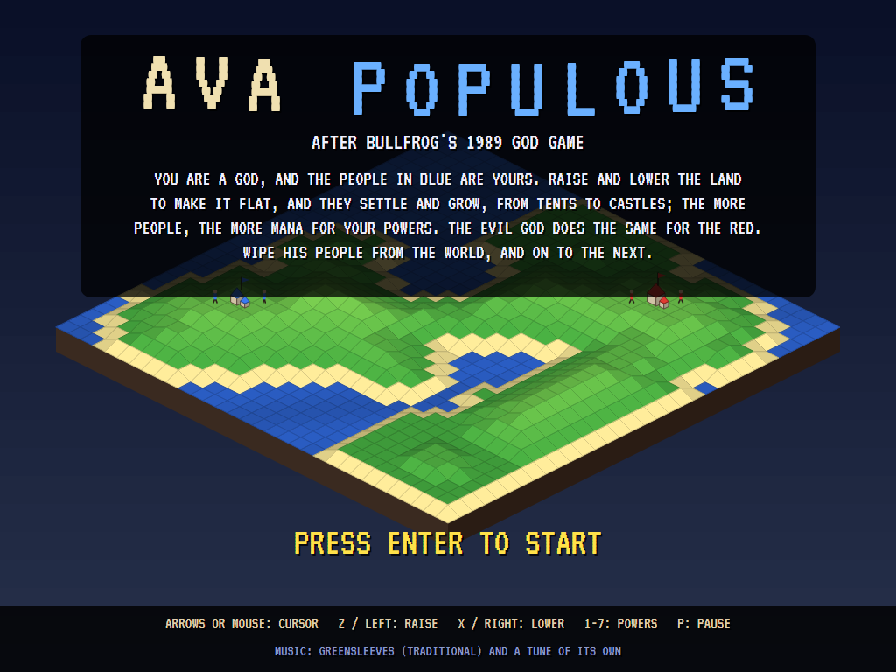
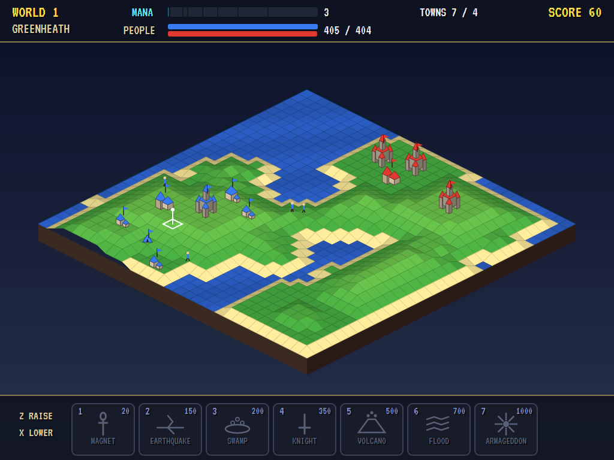
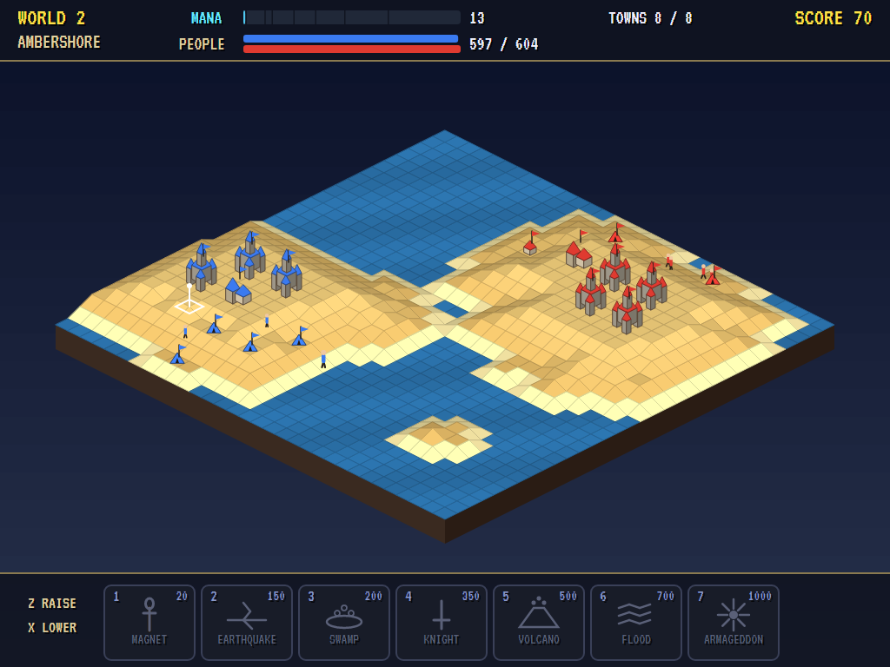
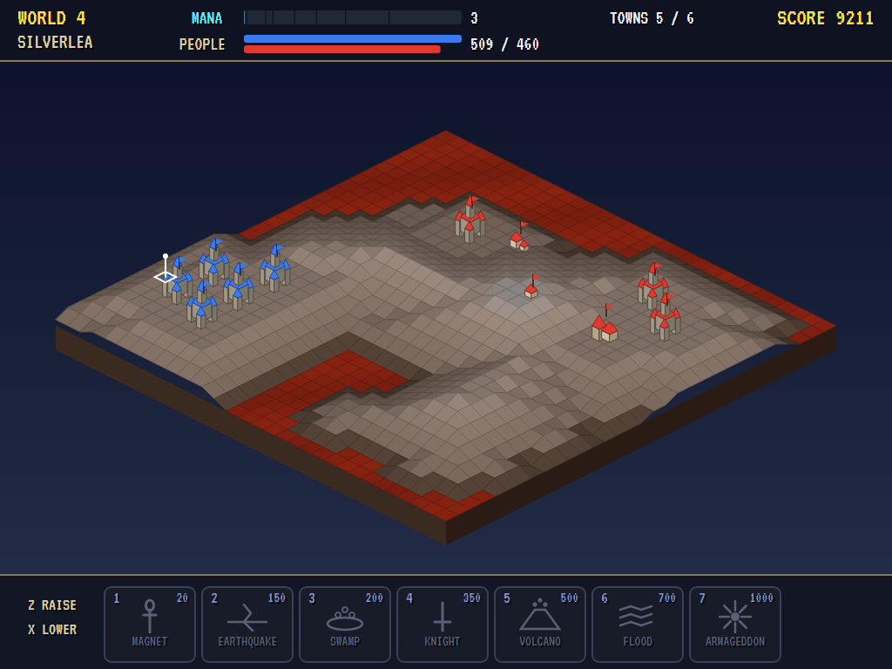
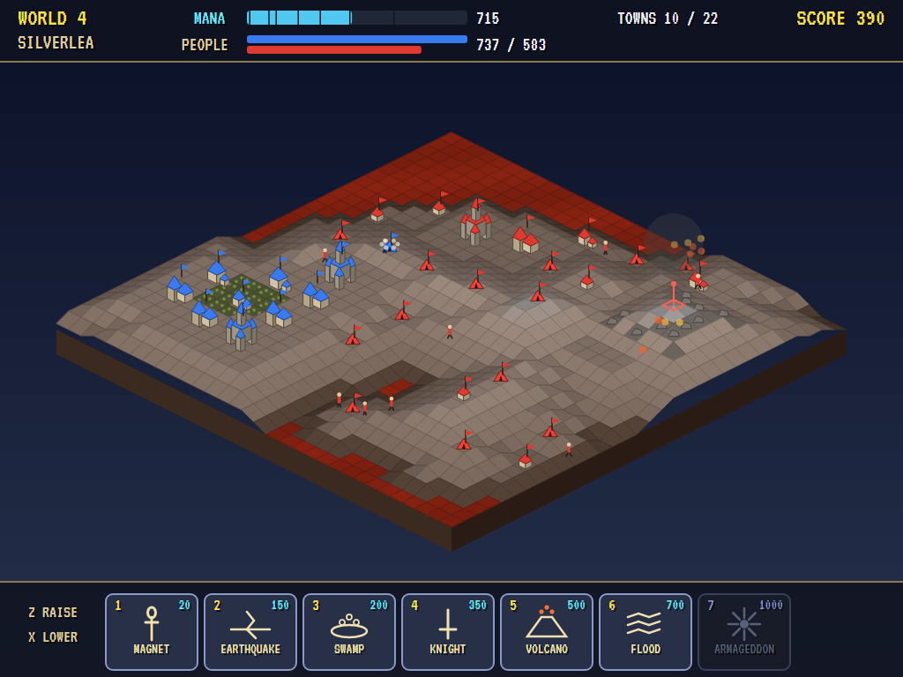
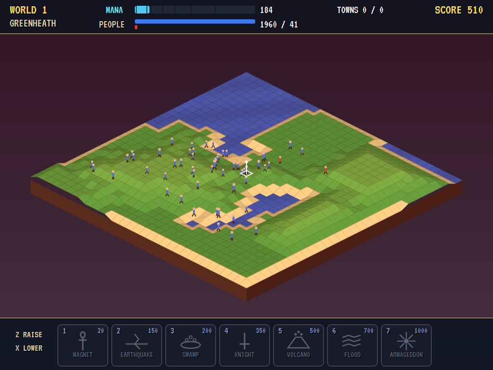
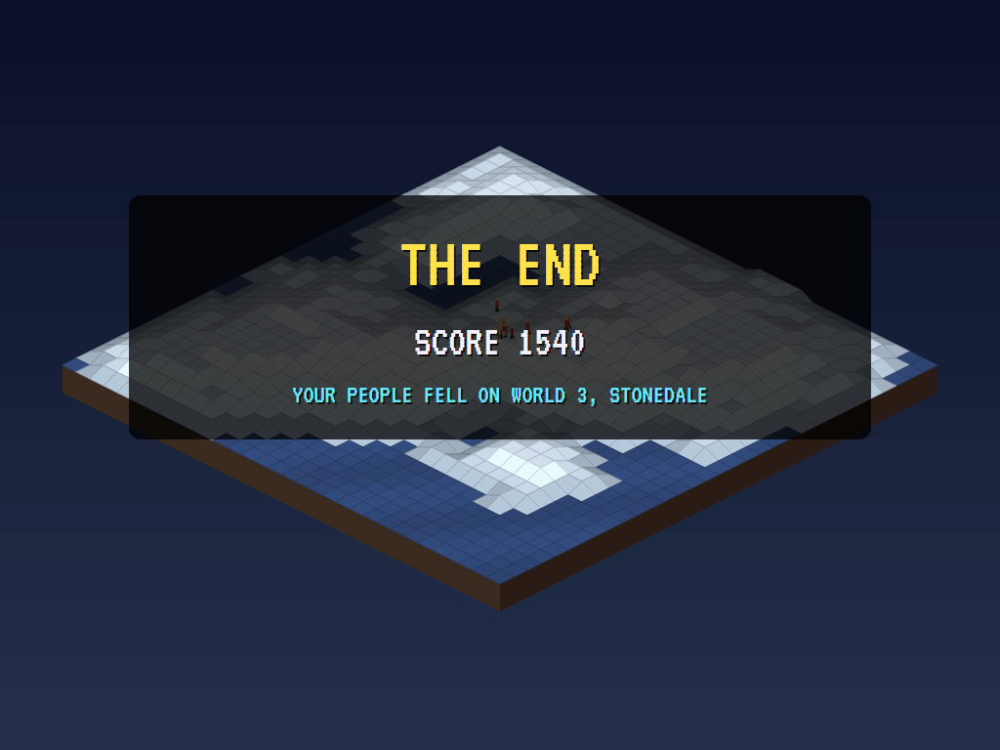
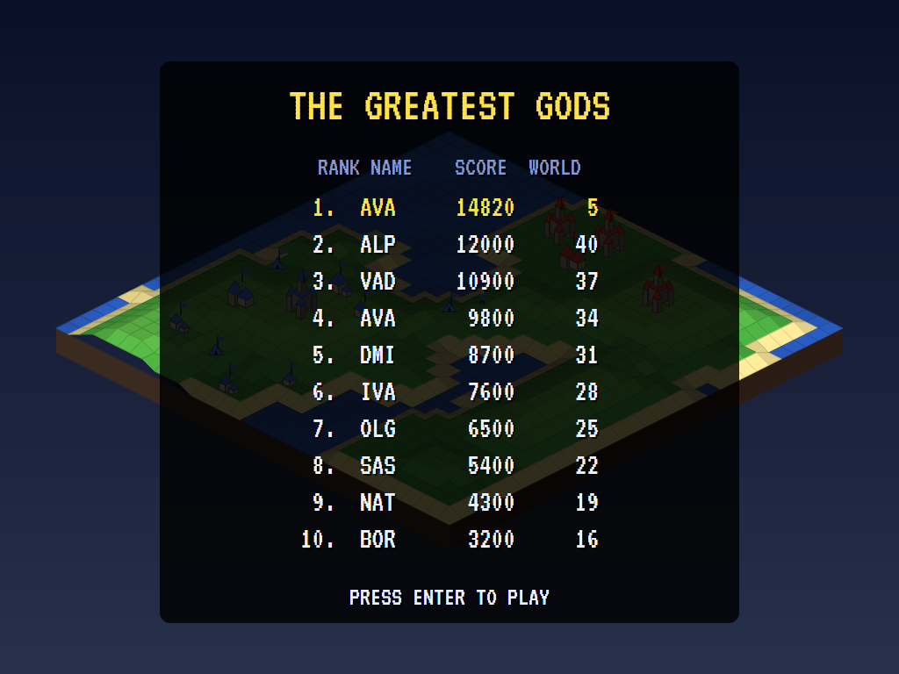

# AVA Populous

[](https://github.com/Harlock123/AVAPopulous/actions/workflows/build.yml)

A god game in the style of Bullfrog's 1989 **Populous**, built with .NET 10 and Avalonia UI. You are a god, and the
people in blue are yours. Raise and lower the land to make it flat, and they settle on it and grow, from tents to
castles. The more of them there are, the more mana you have for your powers: earthquakes, swamps, a knight,
volcanoes, the flood and Armageddon. The evil god does the same for the people in red. Wipe his people from the
world, and go on to the next.

## Features

- **The land** is an island of 32 by 32 tiles, seen corner-on, with a height at every corner from the sea up to the
  snow. Raise a corner and the land round it rises with it, so no corner is ever more than a step above its
  neighbour; lower it and the land round it comes down. You can shape the land only near your own towns, or right
  where one of your walkers stands. Each step costs a little mana.
- **The people** walk the land looking for flat ground, and settle where there's most of it round them. A town is a
  tent, a hut, a cottage, a house, a manor or a castle, by how much flat land of its height lies within two tiles
  of it. It grows to fill its size, then sends half its people out to find land of their own. Move the land under a
  town and it falls, and half its people are lost; sink it into the sea and they all drown. Walkers go round water,
  grow hungry as they wander, and join their own towns as they pass.
- **War:** walkers of the two sides meeting fight it out, and the stronger walks on, weaker by the other's strength.
  A walker into the other side's town takes it if stronger, and is lost if not. A walker with nowhere to settle, and
  strong, goes for the other side's nearest town.
- **Seven powers**, each with its price in mana:
  - **Magnet (20):** an ankh where your people are to gather; send them at the enemy.
  - **Earthquake (150):** the land shaken out of true, and the towns there fall.
  - **Swamp (200):** seven tiles of flat land made swamp; anyone who walks in drowns. Swamps dry up after 40 seconds.
  - **Knight (350):** your strongest walker made half as strong again, who never settles but hunts the other side's
    towns and burns them, until he tires.
  - **Volcano (500):** a mountain of rock thrown up, and the towns under it burn.
  - **Flood (700):** the whole world lowered a step, and the towns at the shore drown.
  - **Armageddon (1,000):** every town empties, and everyone marches to the middle of the world to fight it out.
- **The evil god** shapes the land for his people, and calls down his powers when he can afford them. He gets the
  earthquake on the second world, the swamp on the third, the knight on the fourth, the volcano on the sixth and the
  flood on the eighth. He is quicker each world, gets more mana, and learns to sink your towns from under them.
  When he's far ahead, he saves for Armageddon.
- **Worlds** in four kinds of land in turn: green, desert, snow and lava. Win one and the next has its own shape.
- **Scoring:** 10 for every town your people build, 100 for every town of his they take, 50 for each burnt by your
  volcano, and on winning a world 1,000 times its number and a point for every one of your people left.
- **The attract mode** shows the computer god at work, with the evil god's mind turned to the good. It flattens
  ground for walkers with nowhere to settle, then the land round its towns, nearest to the next size first, so they
  grow to castles. Then it prepares new ground three tiles out. It never moves a corner that would bring down a town
  of its own, and it sinks his big towns within its reach. It calls down swamps, knights and the magnet when it can,
  and when it's far ahead it saves for Armageddon. It wins eleven of the first twelve worlds.

## Screenshots

| The title | Settling | The desert |
|:---------:|:--------:|:----------:|
|  |  |  |
| | Tents to castles. | The second world. |

| Castles | A volcano | Armageddon |
|:-------:|:---------:|:----------:|
|  |  |  |
| On the lava world. | Under his biggest town. | Everyone to the middle. |

| Game over | The greatest gods |
|:---------:|:-----------------:|
|  |  |

The screenshots are made by the tests, which play the game in a real (headless) window; see
[Tests](#tests).

## Download and run

Ready-to-run builds for Windows, macOS and Linux, on both Intel/AMD and ARM, are on the
[Releases page](https://github.com/Harlock123/AVAPopulous/releases/tag/latest). **Latest build** is
rebuilt on every push to `main`. Each download is one self-contained executable: no .NET install is
needed.

| Platform | Archive |
|---|---|
| Windows | `AVAPopulous-win-x64.zip`, `AVAPopulous-win-x86.zip`, `AVAPopulous-win-arm64.zip` |
| macOS | `AVAPopulous-osx-arm64.tar.gz` (Apple silicon), `AVAPopulous-osx-x64.tar.gz` (Intel) |
| Linux | `AVAPopulous-linux-x64.tar.gz`, `AVAPopulous-linux-arm64.tar.gz`, `AVAPopulous-linux-arm.tar.gz` |

```bash
tar -xzf AVAPopulous-linux-x64.tar.gz     # or linux-arm64, linux-arm, osx-arm64, osx-x64
./AVAPopulous
```

On Windows, unzip and run `AVAPopulous.exe`. On macOS, if Gatekeeper refuses to open it, run
`xattr -d com.apple.quarantine AVAPopulous` once. Run with `--no-audio` for silence.

**Sound** comes through OpenAL Soft, built in for every platform. In a virtual machine the game
detects it and uses a larger audio buffer, so the sound doesn't break up.

**Gamepads** use SDL2, which is bundled for Windows, macOS and Intel/AMD Linux. ARM Linux builds need it
installed; without it the keyboard still works:

```bash
sudo apt install libsdl2-dev            # Debian / Ubuntu / Raspberry Pi OS
sudo pacman -S --needed sdl2-compat     # Arch / Omarchy
```

## Controls

| Action | Keyboard | Mouse | Gamepad |
|---|---|---|---|
| Start | Enter | | Start |
| Move the cursor | Arrows or WASD (they move it the way they point on screen) | Point at a corner | Left stick / D-pad |
| Raise the land | Z or Space (hold to go on) | Left button | A |
| Lower the land | X | Right button | B |
| A power | 1 to 7: cast at the cursor | Click it on the bar, then click the land (right-click to cancel) | Y to choose, X to cast |
| Pause | P or Esc | | Start |
| Sound on/off | M | | |
| Screenshot | Ctrl+S (to your Pictures folder) | | |

The cursor is white where you can shape the land and red where you can't. On the high-score table, type your
initials, or use up/down and Space, then Enter.

## Tests

```bash
dotnet test AVAPopulous.slnx
```

The game runs in fixed 60 Hz steps, so it plays the same at any frame rate. Everything that changes lives in
one world that can be copied. The tests check:

- **The land:** raising and lowering, never more than a step between neighbours; every world an island with a home
  for each people; shaping costing mana, and only near your own towns.
- **The people:** settling on flat land, and towns growing with the flat land round them; a full town sending half
  its people out; a town falling when its land moves, and drowning when it's sunk; walkers going round water, and a
  swamp swallowing them until it dries; fights between walkers; taking a town, or being lost to it; mana coming
  with people.
- **The powers:** the knight, the flood, the volcano, the earthquake and Armageddon; the evil god's powers coming
  world by world.
- **The gods' minds:** the computer god winning the first five worlds; a god who does nothing losing.
- **The game:** the cursor and the mouse; a power cast once on a key press, and refused without the mana; a world
  won and the next begun; a world lost, the end and a high score; the demonstration and high scores; a copied
  world going on as the original; the keys.

`tests/AVAPopulous.Tests/PilotProbe.cs` reports how the computer god gets on, world by world, for tuning
(`POPULOUS_PROBE=1`, `POPULOUS_WORLDS=12`). It wins eleven of the first twelve, in two to six minutes each.
`POPULOUS_PROBE=lazy` does nothing at all, and the evil god wipes out its people in under four minutes a world.

The screenshot tests draw the real screen in a headless window. To refresh the README's pictures:

```bash
POPULOUS_SHOTS=$PWD/Images dotnet test tests/AVAPopulous.Tests --filter ScreenshotTests
```

## Building

```bash
dotnet build AVAPopulous.slnx
dotnet run --project src/AVAPopulous
```

Needs the .NET 10 SDK. The sounds, music and voice are made by `tools/make_sounds.py` (standard-library
Python, with the formant voice in `tools/speech.py`): `python3 tools/make_sounds.py` rewrites
`src/AVAPopulous/Sounds`.

## Project structure

```
AVAPopulous/
├── AVAPopulous.slnx
├── src/AVAPopulous/
│   ├── Engine/
│   │   ├── GameEngine.cs        # States, worlds, the cursor, the demonstration
│   │   ├── Sim.cs               # The land and its shaping, towns, walkers, fights, the powers, mana
│   │   ├── World.cs             # The land, the peoples and the gods, kept so they can be copied
│   │   ├── Pilot.cs             # The gods' minds: the evil god's, and the good god's in the demonstration
│   │   ├── HighScoreTable.cs, InitialsEntry.cs
│   │   ├── InputHandler.cs, ControllerManager.cs  # Keys, the mouse and an SDL2 gamepad
│   │   └── SoundManager.cs      # Effects, music and voice through OpenAL
│   ├── Audio/                   # The OpenAL engine (from the author's AVABand)
│   ├── Views/GameCanvas*.cs     # The land corner-on, the towns and walkers, the powers bar, the title
│   └── Sounds/                  # The synthesised effects, music and voice
├── tests/AVAPopulous.Tests/     # Gameplay and screenshot tests
├── tools/make_sounds.py, tools/speech.py
└── Images/                      # Screenshots
```

## About and licence

AVA Populous © 2026 Lonnie Watson, under the [MIT License](LICENSE).

*Populous* © 1989 Bullfrog Productions; the name *Populous* belongs to its current owner (Electronic Arts). AVA
Populous is an independent, unofficial game in its style. Its graphics, sounds and code are its own; nothing is
taken from the original game's program, graphics or sound. It is not affiliated with or endorsed by any rights
holder. The title music is *Greensleeves*, a traditional English air; the tune in play is the game's own.
